<p align="center">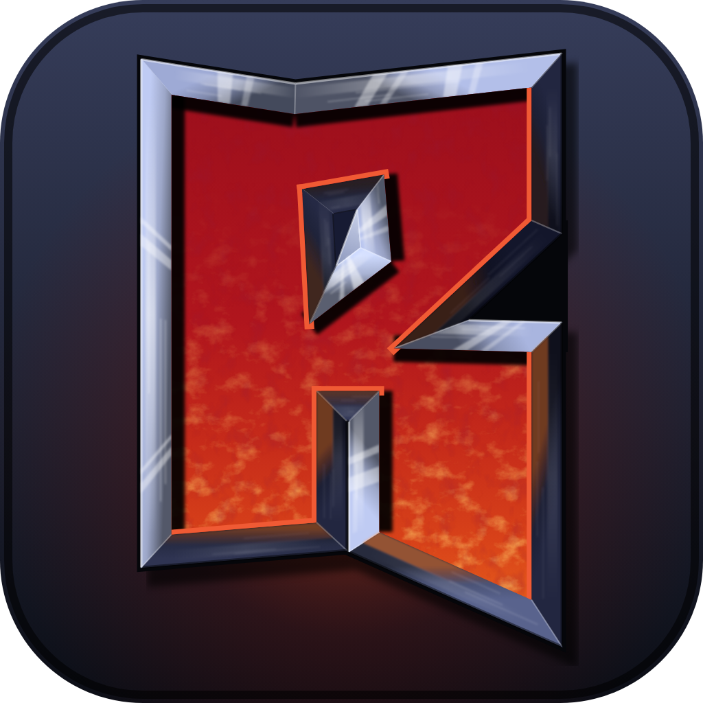</p>

# Turok: Rage Wars (N64) - decompilation of every release

Goal: a matching decompilation (C that compiles to the original bytes) of all releases of the game - US v1.1, US v1.0, Europe and Germany
(*Turok: Legenden des Verlorenen Landes*) - from one shared source tree, then a native PC port.
Reference ROM: `baserom.us.v11.z64`, SHA1 `037fb397cee2669048ed6b762a64698de4a4d88a`; the other releases are listed in `docs/VERSIONS.md`
(none are included; never commit them).

## Playing the PC port (Windows)

The port (`port/`) runs Turok: Rage Wars natively on Windows: Direct3D 11 renderer, the game's own audio, keyboard / mouse / gamepad
input with a mapping program, and virtual Controller Paks (memory cards) for your saves.  It runs all
the menus through to 1-4 player matches (split screen, bots).

<p align="center">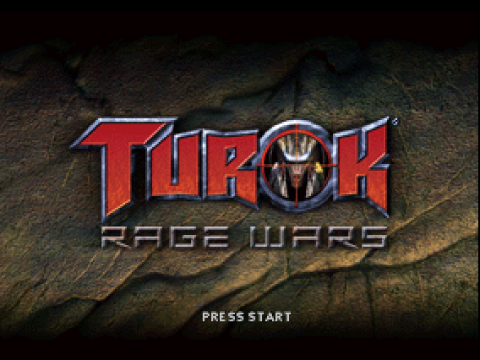</p>

| | |
|:-:|:-:|
| 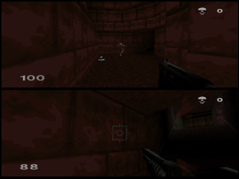 | 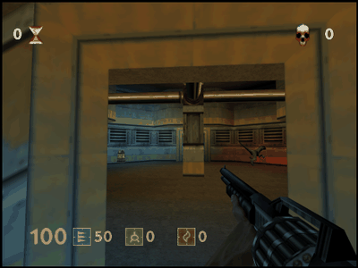 |
| Attract demo (split screen, bots) | 1 Player Trials |

| | |
|:-:|:-:|
| 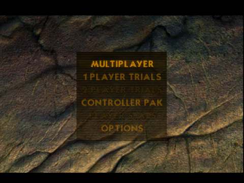 | 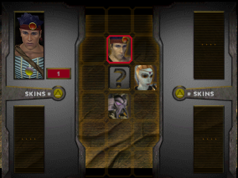 |
| Main menu | Character select |
| 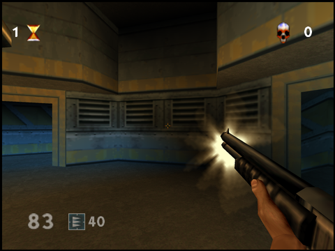 | 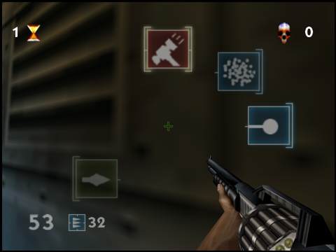 |
| 1 Player Trials | Weapon wheel (mouse picks the weapon) |
| 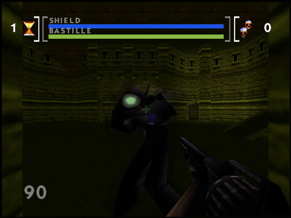 | 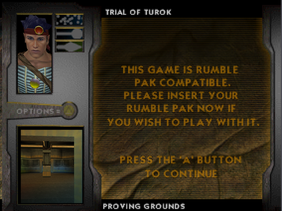 |
| Boss: Bastille | Trial briefing |

*Screenshots and GIF taken from the PC port (rendered at 1920x1440, scaled down).*

**No game data is included.**  You need your own ROM of *Turok: Rage Wars* (USA, version 1.1, 8 MB; `.z64`, `.n64` or `.v64`
all work).  The port checks the file and refuses other releases or a damaged dump.  The PC port runs USA v1.1 only; the other
releases are covered by the decompilation, not by the port yet.

### 1. Build it

**The easy way:** double-click **`build.cmd`** in the project folder.  It checks the tools it needs and offers to install
what is missing (Python 3 and the Visual Studio C++ build tools, through winget; it asks first), sets up its own Python
environment in `.venv`, asks for your ROM (a file dialog; `.z64`, `.n64` and `.v64` are fine, it is checked and converted),
and builds the game and the controls program.  The first build takes 20-40 minutes, later ones a few minutes.  Everything
it does is logged in `build.log`.  Run it again after `git pull` to update; `build.cmd -Rebuild` starts from scratch.

What it needs (installed for you if you agree):
- Windows 10 or 11.
- **Python 3.9+** (python.org or `winget install Python.Python.3.12`).
- **Visual Studio 2022 or 2026** (Build Tools or Community) with the *Desktop development with C++* workload.
- No WSL: the disassembly the port is built from is made with `rabbitizer` (port/rab_dis.py, checked identical to the
  `mips-linux-gnu-objdump` output it replaced; `PORT_ASM_OBJDUMP=1` still uses objdump in WSL).

By hand (what build.cmd does), in PowerShell from the project folder:
```
python -m venv .venv
.venv\Scripts\pip install splat64[mips]==0.50.0 spimdisasm==1.42.4 rabbitizer==1.16.2 crunch64==0.6.2 PyYAML==6.0.3 ziglang==0.16.0
$env:PATH = "$PWD\.venv\Scripts;$env:PATH"                 # the build scripts call "python -m ziglang"
.venv\Scripts\python -m splat split turok_ragewars.yaml   # needs baserom.us.v11.z64 in the project folder
.venv\Scripts\python tools\fix_asm.py
python port\regen.py --asm --all                          # the whole game (later: python port\regen.py)
powershell -File port\build_config.ps1                    # the controls program turok_controls.exe
```
The game ends up in `port\build\` (the newest exe is named in `port\build\latest_exe.txt`).

### 2. Start it

Double-click **`port\play.cmd`** (or run it from a console; `port\play.cmd -fullscreen` / `-windowed` force a mode).

On the first start the game asks for your ROM: pick the file in the dialog.  It is checked (SHA-1) and a copy is kept in
`%LOCALAPPDATA%\TurokRageWars`, so you are asked only once.  A ROM named `baserom.us.v11.z64` in the project folder is
found without asking.

| Key | What it does |
|---|---|
| **Ctrl+Enter** or **Alt+Enter** | window / full screen (borderless; the choice is remembered) |
| **F1** | capture / release the mouse |
| **F2** | reload `controls.ini` (changes are also picked up automatically) |
| **F3** | write a device report (which pads are seen, who plays with what) to the log |
| **Esc** | releases the mouse; with the mouse free, press twice to quit |
| **Ctrl+F5..F8** / **Ctrl+Shift+F5..F8** | pull out / push in the memory pak / rumble pak of controller 1..4 |

### 3. Controls

Out of the box player 1 has keyboard + mouse + the first gamepad, and players 2-4 get the next gamepads that are plugged in.

| Keyboard / mouse (`kbm_fps`) | N64 | | Xbox-style pad (`xbox`) | N64 |
|---|---|---|---|---|
| W A S D | move / strafe (C buttons) | | left stick | move / strafe (C buttons) |
| mouse | look / aim (stick) | | right stick | look / aim (stick) |
| left button | fire (Z) | | RT | fire (Z) |
| right button | secondary fire (B) | | LT or B | secondary fire (B) |
| E, C, middle button, wheel | weapon select (A) | | X or Y | weapon select (A) |
| Space | jump (R) | | A or RB | jump (R) |
| Q | L | | LB | L |
| Enter | Start | | Start | Start |
| arrow keys | stick | | D-pad | D-pad |

**Native mouse and keyboard** (`native_controls = on`, the default): in a level the mouse turns and tilts the view directly, 1:1 with
the mouse and with no speed limit, and W A S D walk and strafe, whichever control style is selected in the game's options.  (The
original game only knows an analog stick; without this the mouse is converted to stick deflection and is capped at the stick's
turn speed.)  `native_controls = off` in `controls.ini` goes back to the stick emulation.

In menus W A S D / the arrow keys / the wheel move the cursor and the left mouse button confirms.  Other built-in layouts:
`xbox_n64` (the classic N64 mapping: left stick = stick, right stick = C buttons), `kb_left` + `kb_right` (two players on one
keyboard) and `generic` (other DirectInput pads; PlayStation and Logitech pads are recognised by name).

#### The controls program: `turok_controls.exe`

`port\build\turok_controls.exe` edits the mapping with a picture of the N64 controller instead of a text file:

- **One tab per player**: choose the devices (keyboard, mouse, a specific pad or "first free pad") and a starting layout.
- **Rebind**: click (or double-click) a button on the controller picture, then press the key, mouse button, wheel, pad button,
  stick or trigger you want; move the mouse to bind a stick direction.  Conflicts (the same input on two N64 buttons, the same
  key for two players on a shared keyboard) are flagged.
- **Tune**: mouse sensitivity / smoothing / invert, stick dead zone, response curve and sensitivity, trigger threshold.
- **Test live**: the test area shows the N64 controller as the game would see it, including the stick circle.
- **General tab**: mouse capture mode, Esc behaviour, rumble on / off and strength, input in the background, the list of connected devices.
- Copy settings between players, import / export, reset to defaults, and **Launch game**.

It saves `controls.ini` next to the game; a running game picks the change up at once.

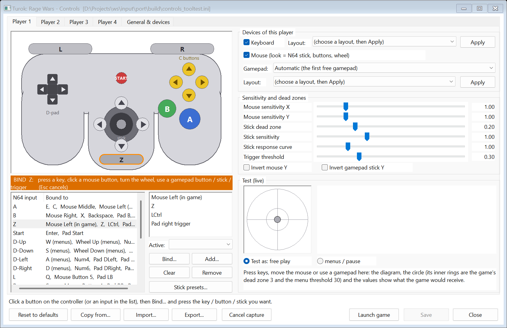
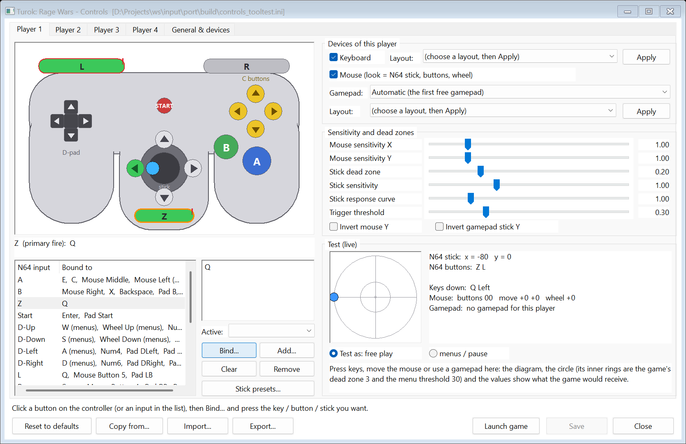

#### Or edit `controls.ini` by hand

`controls.ini` sits next to the exe (`port\build\`), or wherever `TUROK_CONTROLS=<file>` points.  The program writes its full
documentation as the file header; a sample is in `port\config\controls.example.ini`.  Short version:
```
[general]
mouse_capture = auto          ; auto (while a level runs) | click | off
rumble = on
rumble_strength = 0.8

[player1]
devices = keyboard, mouse, pad:auto
profile = kbm_fps             ; start from a layout, then override single inputs:
mouse_sens_x = 1.5            ; 1.0 = 0.05 degrees per mouse count
Z = Mouse1, Pad.RT
R += LCtrl                    ; "+=" adds to what the layout gave
A = game:E, menu:Enter        ; game: / menu: limit a binding to play or to menus

[player2]
devices = pad:auto
profile = xbox
```
Keys are named by their **physical position on a US keyboard** (so W A S D stay under the same fingers on AZERTY / QWERTZ).

### 4. Saves: virtual Controller Paks

The game saves player profiles on a Controller Pak, as on the console (1 PLAYER TRIALS -> CREATE PLAYER; the main menu's
CONTROLLER PAK screen deletes them).  Each controller port has its own pak file in the `saves` folder next to the exe:
`Turok; Rage Wars_Cont_1.mpk` ... `_Cont_4.mpk`.  They are ordinary 32 KB `.mpk` images, the same files **Project64**
uses, so saves can be copied in both directions (mupen64plus 4-in-1 files and DexDrive `.n64` images work too).  Back up
by copying the files, ideally with the game closed.

Optional settings go in `turok_pak.ini` next to the exe (copy `saves\turok_pak.ini.sample`): another save folder, a
Project64 save folder to use directly, a specific file per port, or a **rumble pak instead of a memory pak** (`port1 = rumble`;
a port holds one accessory, as on the console; vibration needs an XInput pad).  `saves\README.txt` has the details.

### Troubleshooting

- **"No build yet"** from play.cmd: run `build.cmd` (step 1).
- **The ROM is refused**: the message names what the file is; the port needs USA v1.1 (SHA-1 `037fb397...d88a`).
- **A gamepad does nothing**: start `turok_controls.exe` and look at the General tab's device list, or run
  `turok_controls.exe --devices --out devices.txt`; in the game F3 writes the same report to the log.  Gamepad support was
  developed against virtual pads, so reports from real hardware are very welcome.
- **The mouse turns too slowly / feels laggy, or W A S D do nothing**: make sure `native_controls` is not switched off in `controls.ini`;
  `mouse_sens_x` / `mouse_sens_y` set the speed (1.0 = 0.05 degrees per mouse count), `mouse_invert_y = on` flips up / down.
  The game's own turn / look speed sliders (OPTIONS) scale the mouse as well: centre = 1x, full = 8x, empty = 1/8x (multiplied with the values above).
  Weapon wheel: hold the weapon button (A: E / middle mouse in `kbm_fps`) and move the mouse towards a weapon, release to take it; the view stays still meanwhile.
- The full technical notes (renderer, audio, recompiler, input, pak emulation) are in `docs/PORT_STATUS.md`.

## Workflow
Windows side (needs the venv: `python -m venv .venv; .venv\Scripts\pip install splat64[mips]`):
```
.venv\Scripts\python -m splat split turok_ragewars.yaml
.venv\Scripts\python tools\fix_asm.py
```
WSL side (Ubuntu-24.04; `bash tools/get_gcc.sh` once to fetch compilers into tools/gcc):
```
wsl -d Ubuntu-24.04 -- bash /mnt/d/Projects/TurokRageWars/tools/wsl_build.sh
```
`wsl_build.sh` syncs to `~/trw` (old gcc cannot read files on /mnt/d), runs `make`, and verifies the result is
byte-identical to the base ROM. Compilers: decompals/old-gcc; libultra is GCC 2.8.1 `-O2 -fforce-addr -fno-builtin -mcpu=r4300` (docs/libultra.md).

## Layout
- `src/` C sources (matched); `src/libultra/` libultra functions.
- `asm/` splat's disassembly of everything not yet decompiled (generated; gitignored). `asm/nonmatchings/` for INCLUDE_ASM.
- `symbol_addrs.txt` names and addresses recovered from the ROM. `docs/` notes and the libultra match table.
- `tools/` analysis and build helpers. `tools/as.sh`: assembles pieces without gas's 16-byte section padding.
- `tools/cc.sh`: compiler wrapper (post-processes `move` -> `addu`; libultra vs game code differ in delay-slot handling).

## Converting a function to C
1. Add a `[start, c, path/name]` subsegment (ROM offsets, function boundaries) to `turok_ragewars.yaml` and a source file.
2. Name its symbols in `symbol_addrs.txt`; re-run splat + fix_asm.py; build. It must stay byte-identical.

Notes: libultra objects are padded to 16 bytes with *garbage* (copies of other code); splat keeps those words in asm and
`tools/fix_asm.py` turns any padding "branch" that points outside its file into a raw `.word`.

## Status (2026-10-11)
- **US v1.1 (reference)**: `powershell tools/cycle.ps1` rebuilds the ROM byte-identical.  All game code (main image `src/game/` and overlay A `src/ovl_a/`)
  is matched C, apart from the original's own hand-written assembly (boot code, exception handler, TLB / cache / status-register routines, kept as readable `.s`
  sources listed in `docs/hand_asm.txt`) and stray linker-padding words between objects (`pad_*.s` units).  libultra / libaudio (`src/libultra/`) is matched
  completely (the last three, `__osContRamRead`, `__osDevMgrMain` and `sinf`, were matched on 2026-10-12).
  `tools/progress_chart.py` draws the numbers.
- **US v1.0, Europe, Germany**: each builds byte-identical from the unchanged v1.1 C (about 3,400-3,600 shared units) plus splat asm for the code that
  differs; that release-specific code (200 functions for US v1.0, ~290 each for Europe and Germany) is being matched now (`docs/VERSIONS.md`).
- **Toolchain** (the big finding): the other public decompilation of this game, [melalawi/ragewars-decomp](https://github.com/melalawi/ragewars-decomp)
  (CC0), builds everything with the pmret gcc 2.8.1 `cc1` (`-O2 -mgas -mcpu=VR4300 -mhard-float -mgp32 -mfp64 -mno-fix4300`), the SN64
  assembler normaliser `n64link asn64` and GNU as (gcc 2.7.2 for a few low-region units).  Our older decompals-gcc + `tools/gas_compat.py`
  emulation is an approximation; functions can now be built in `mode=sn` (`tools/cc.sh`; tokens `+sa +r4k +epi +nb ...` or `sn272`
  in `funcs.txt`).  `tools/sn_setup.sh` installs the three programs (download + sha256 from their pinned releases); the checker takes the
  token `@SN` / `@SN272`.  `include/their` and `their_syms.ld` are their headers and symbol table (CC0); `tools/port_their.py`,
  `tools/port_sn.py`, `tools/dropfix.py` integrate matched functions and keep the build byte-identical.
- **Assets / maps**: `docs/ROM_MAPS.md` documents the resource directory (36 map records, 347-mesh library, 507 texture banks, RNC
  compression); `tools/rnc.py`, `tools/extract_assets.py`, `tools/dump_maps.py` produce the raw dumps (output gitignored).
- **Windows port** (`port/`, `docs/PORT_STATUS.md`): runs the game natively (32-bit x86, Direct3D 11 F3DEX2 renderer, libultra audio with an
  ABI1 audio HLE, scripted input) through the menus into 1-4 player matches; functions without matching C are exact static recompilations
  of the ROM code (`port/mips2c.py`).  `TUROK_MAPDUMP=1` captures the static world geometry the renderer draws to OBJ.
- Parallel matching workflow: `tools/mkws.py` / `tools/mkround.py` (isolated workspaces), `tools/fchk.ps1`, `docs/AGENT_GUIDE.md`,
  `docs/GAME_GUIDE.md`, `docs/FINDINGS_all.txt` (combined lessons). `tools/chk.py` compares code AND the literal pool with the ROM (`tools/rodoc.py` diffs a whole rodata piece). C/H/TXT files must keep LF line endings (`.gitattributes`).
